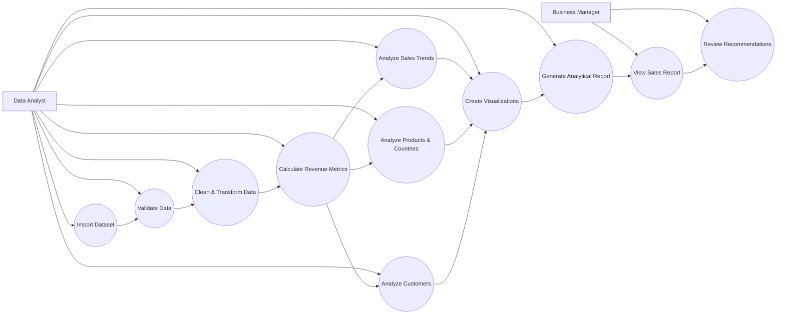

# Use Case Model — E-Commerce Sales Analysis

## Purpose
This model describes how project users interact with the E-Commerce Sales Analysis solution. It replaces the earlier order-management use case example so that the project documentation is consistent.

## Actors
- **Data Analyst** — imports, validates, cleans, transforms, analyzes, and visualizes sales data.
- **Business Manager** — reviews reports, trends, product performance, market performance, customer insights, and recommendations.

## Use Case Diagram

## Use Case Specifications

### UC-01: Import Dataset
**Primary actor:** Data Analyst  
**Goal:** Load an e-commerce dataset into the analysis environment.  
**Precondition:** A valid dataset file is available.  
**Main flow:**
1. Analyst selects the dataset.
2. System loads the file using Python/Pandas.
3. System displays columns, row count, and basic structure.
4. Analyst confirms the dataset was loaded correctly.

**Alternative flow:** If the file cannot be read, the analyst checks file type, encoding, or source and retries.

### UC-02: Validate and Clean Data
**Primary actor:** Data Analyst  
**Goal:** Prepare reliable data for analysis.  
**Precondition:** Dataset has been imported.  
**Main flow:**
1. Check missing values.
2. Check duplicate records.
3. Verify data types.
4. Identify invalid or inconsistent values.
5. Correct or remove problematic records according to documented rules.
6. Create derived fields such as total revenue where required.

**Postcondition:** A cleaned dataset is ready for analysis.

### UC-03: Analyze Sales Performance
**Primary actor:** Data Analyst  
**Goal:** Answer the project's business questions.  
**Main flow:**
1. Calculate total and average revenue.
2. Analyze monthly sales trends.
3. Rank products by quantity and revenue.
4. Compare sales by country or market.
5. Identify high-value customers.
6. Calculate average order value.

### UC-04: Create Visualizations
**Primary actor:** Data Analyst  
**Goal:** Convert analytical results into clear charts.  
**Main flow:**
1. Select a suitable chart for each business question.
2. Generate charts using the cleaned analytical data.
3. Add readable labels, titles, and units.
4. Verify that charts accurately represent the calculations.

### UC-05: Generate Analytical Report
**Primary actor:** Data Analyst  
**Goal:** Summarize findings and recommendations.  
**Main flow:**
1. Combine key metrics, tables, and charts.
2. Explain important patterns.
3. State evidence-based recommendations.
4. Prepare the final report and presentation materials.

### UC-06: Review Results and Recommendations
**Primary actor:** Business Manager  
**Goal:** Understand business performance and use the findings for decisions.  
**Main flow:**
1. Review the sales report.
2. Compare products, markets, customers, and periods.
3. Identify strong and weak areas.
4. Review recommendations supported by the analysis.
