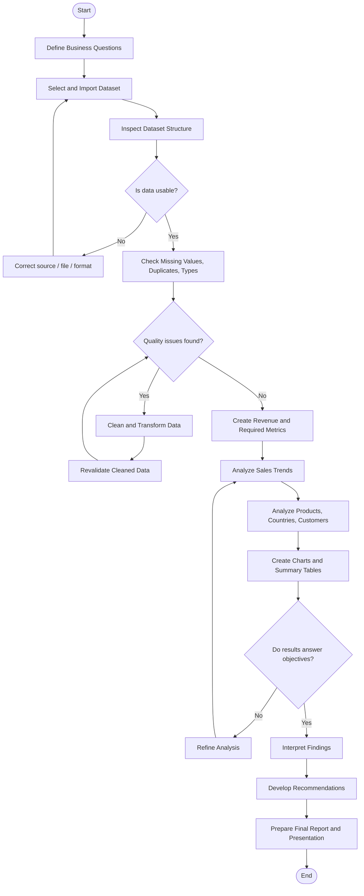

# Business Process Model — E-Commerce Sales Analysis

## Process Objective
Transform raw e-commerce sales data into validated business insights and recommendations.

## BPMN-Style Process

## Process Roles

| Process Stage | Responsible Role |
|---|---|
| Define objectives and business questions | Team |
| Dataset selection and import | Data Analyst / Team Leader |
| Data validation and cleaning | Data Analyst |
| Analysis and visualizations | Data Analyst with team review |
| Interpretation and recommendations | Entire team |
| Final report integration | Team Leader |
| Presentation preparation | Project Speaker with team review |

## Key Decision Points
1. **Is the dataset usable?** If the source, structure, or format is unsuitable, the team corrects the issue or selects another dataset.
2. **Are quality issues present?** Missing values, duplicates, incorrect types, or invalid records are handled before analysis.
3. **Do the results answer the objectives?** If not, the analysis is refined until the project questions are answered with evidence.

## Expected Output
A validated analytical report containing sales trends, product performance, country or market comparisons, customer insights, average order value, charts, and evidence-based recommendations.
