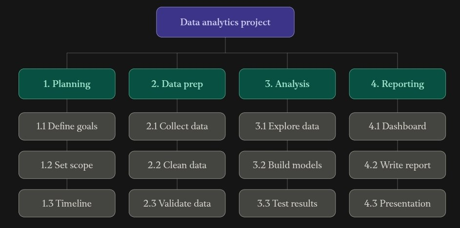

# Work Breakdown Structure — E-Commerce Sales Analysis

## Official WBS Visual

This existing repository image is the WBS that matches the current **E-Commerce Sales Analysis** project:

## WBS Areas

The visual organizes the project into the same major work areas already defined in the project plan:

1. Project planning
2. Data preparation
3. Data analysis
4. Visualization and interpretation
5. Reporting and presentation

The older e-commerce order-management WBS image is kept in the repository only as an earlier classroom example and is not the official WBS for this project.
