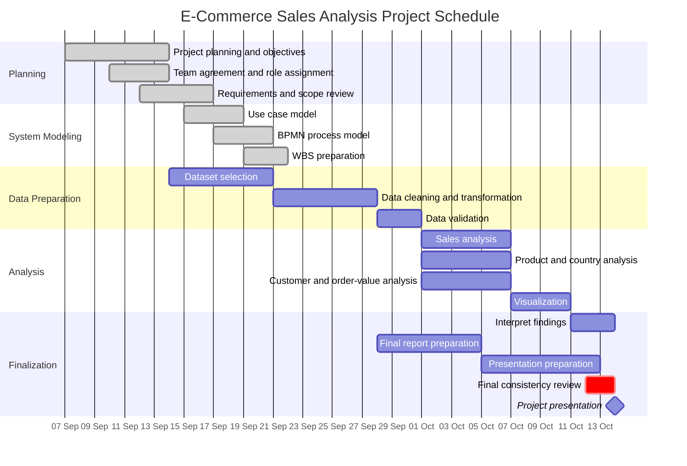

# Gantt Chart — E-Commerce Sales Analysis

## Project Schedule

## Task Dependencies

| Task | Depends On | Main Owner |
|---|---|---|
| Dataset selection | Project objectives | Abdulloh |
| Data cleaning | Dataset selection | Abdulloh |
| Data validation | Data cleaning | Abdulloh / Najmiddin |
| Sales analysis | Validated dataset | Abdulloh |
| Visualizations | Analysis results | Abdulloh / Najmiddin |
| Findings and recommendations | Analysis + visualizations | Entire team |
| Final report | Planning models + analytical results | Abdulloh |
| Presentation | Finalized findings and report structure | Biloliddin |
| Final review | All deliverables | Entire team |

## Milestone
**14 October 2026 — Project Presentation**

This schedule replaces the earlier order-management Gantt example as the official timeline for the E-Commerce Sales Analysis project.
